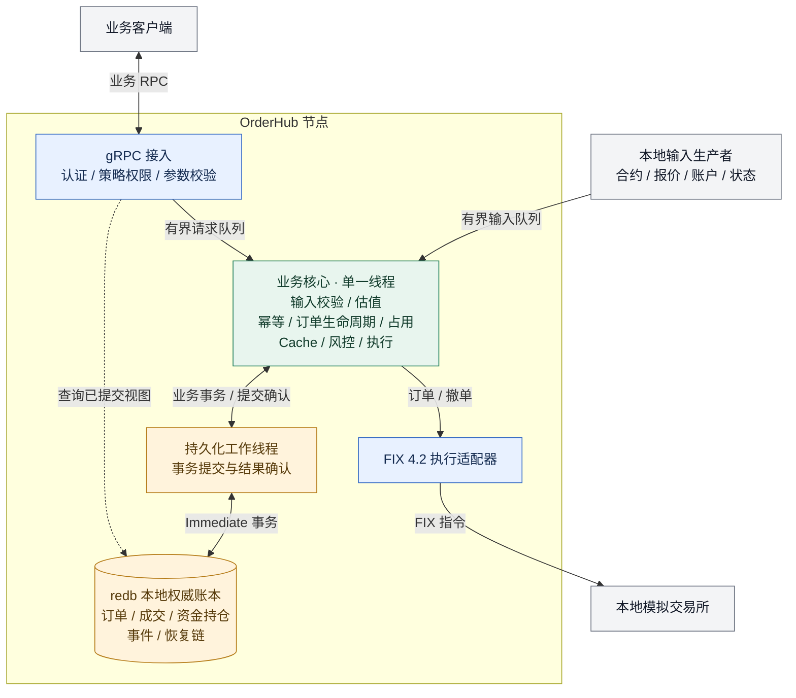
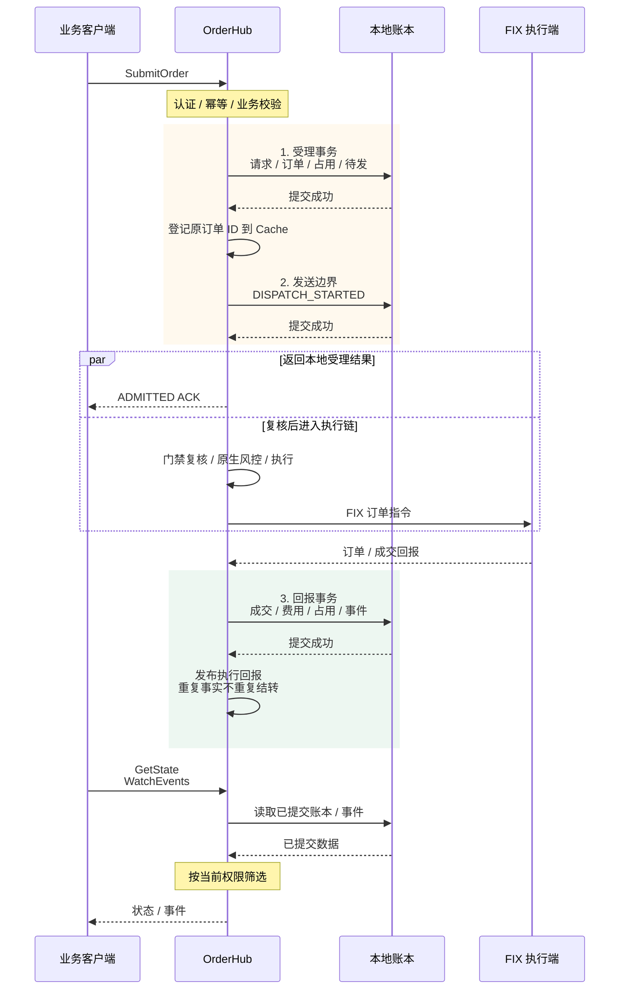
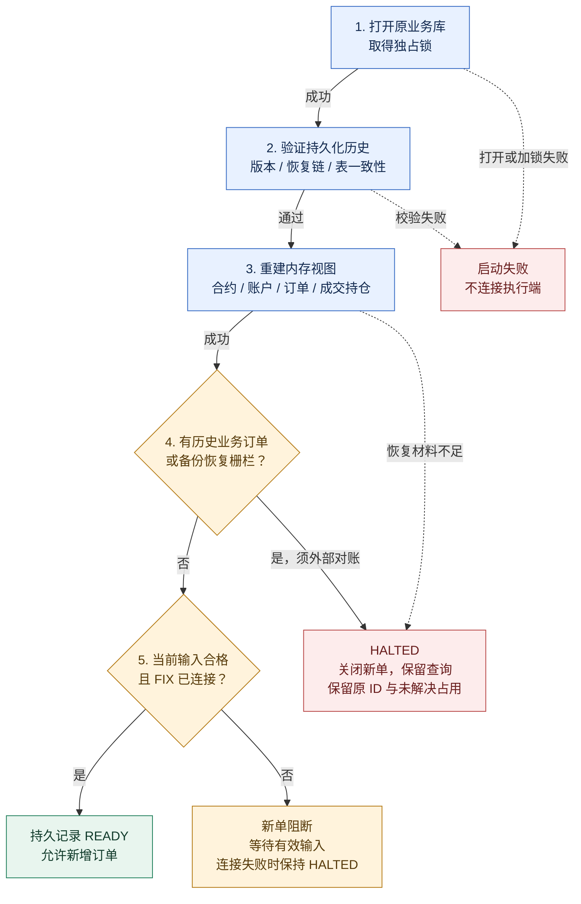

# OrderHub

OrderHub 是用 Rust 实现的订单管理系统（OMS），为交易客户端提供统一的下单、
撤单、状态查询和事件订阅接口。系统负责请求防重、策略权限、资金与持仓占用、
风险检查、执行回报结转及本地持久化恢复，通过 FIX 通道连接执行端。

项目由本仓库独立维护，业务入口、配置、开发流程和运维工具均以 OrderHub 为准。
当前实现面向本地模拟交易和联调；启用真实账户前，需要完成对应执行端和部署环境的验证。

项目仓库：[kmind-git/OrderHub](https://github.com/kmind-git/OrderHub)，默认分支为 `master`。

## 主要功能

- **订单管理**：受理限价单、撤单，维护订单生命周期，处理拒单、部分成交、完全成交及迟到回报。
- **认证与权限**：Bearer 凭证绑定提交方和策略；查询、撤单和订阅按当前权限筛选。
- **幂等与原结果查询**：同代、同提交方、同方法、同请求 ID 的相同参数返回原结果；
  参数冲突明确拒绝，客户端超时重试不会创建第二笔订单。
- **资金与持仓管理**：维护账户和策略的现金、持仓归属、成本、费用预留及订单占用，
  防止不同策略重复使用可用资源。
- **风险与估值**：检查合约精度、交易能力、业务截止时间、现金购买力、卖出归属、
  成本预算和市值敞口；使用精确数值计算与最后合法报价估值。
- **执行接入**：通过本地 FIX 4.2 适配器发送订单、撤单并接收订单与成交回报。
- **本地持久化**：将请求结果、订单、经济事实、占用、输入和事件视图提交到 redb，
  成功提交后才返回受理结果或进入执行链。
- **状态与事件流**：提供固定提交版本的分页快照、订单及请求查询，以及带签名游标的连续事件补流。
- **故障恢复与运维**：验证持久化恢复链、重建内存视图，提供一致检查点及离线检查、备份和恢复工具。

## 当前业务范围

当前节点使用 `local-usd-v2` 规则，范围为：

- 合约 `AAPL.GOX`，账户 `GOX-001`，策略 `ORDERHUB-S001`，币种 USD。
- 整股、限价单、`DAY` 有效期；合约定义提供价格和数量的精度及增量。
- 连续的本地可信 JSONL 输入，包含合约定义、报价、账户资金与策略归属、交易状态。
- 本地 `rust-trader` 模拟交易所的 FIX 执行通道。

该节点尚未提供多账户、多合约的通用配置入口。市价单、改单、
`GTC/IOC/FOK`、`post_only/reduce_only` 及复杂订单不在当前受理范围。

报价用于 Portfolio 估值和敞口计算。当前规则已取消相对卖价的 ±10% 价格带，
也不因报价超过 2 秒、仅报价断流或报价序号缺口阻断新单。
启动或合约修订后仍需至少一条匹配当前合约的合法报价；后续估值沿用最后合法报价，
停更期间可能偏离当前市场。

账户和交易状态的时效检查继续保留，最大陈旧时间分别为 10 秒和 5 秒。
非报价输入异常、整体输入断连、停牌、非授权交易时段、资金或持仓不足，
以及执行、持久化和恢复门禁仍会阻断新增风险。
`GetState.writable/stale` 表示交易可写性及必需输入状态，不表示报价实时性。

当前输入源是本地联调数据，尚未接入真实券商账户或交易所行情。
完整输入和风险规则见[输入契约](docs/orderhub/market-and-account-input.md)及
[额度与占用契约](docs/orderhub/risk-and-reservations.md)。

## 业务逻辑架构

### 系统模块

节点围绕一个业务核心线程运行。下图展示模块职责与主要连接，
订单提交、ACK 和执行回报的先后关系见下一张时序图。



RPC 将值对象送入有界队列，由核心线程处理，不直接访问 Cache。
Cache、风控、执行和 Portfolio 在同一核心线程内协作；
磁盘写入由独立持久化线程执行，核心线程等待提交结果。
查询接口读取已提交账本。FIX 回报须先持久化，再进入执行引擎，顺序如下。

### 事务与执行顺序

图中的 OrderHub 包含接入、业务核心和 FIX 适配器，
本地账本包含持久化工作线程与 redb。以下为正常受理路径：



ACK 和实际 FIX 发送由不同工作路径完成，客户端看到的到达顺序可能不同。
ACK 只确认本地受理结果；执行端接受和成交由后续回报确认。

一次订单的处理顺序如下：

1. 校验凭证、策略权限、请求格式及日志代，检查幂等键和当前业务门禁。
1. 在同一 redb 事务中保存请求键、原结果、订单意图、占用、待发状态、
   事件视图及恢复增量。成功受理 ACK 表示本地提交完成。
1. 先持久记录 `DISPATCH_STARTED`，再复核动态条件，经 Cache、RiskEngine、
   ExecutionEngine 和 FIX 发送。受理 ACK 不代表执行端已接受或成交。
1. 将回报的稳定身份、精确数量、价格、费用和归属先持久化，再发布给执行引擎，
   同事务更新经济账本。重复回报不会重复结转。
1. 客户端从已提交账本查询状态，按签名游标补流；内存广播和 Cache 不作为原受理结果的权威来源。

撤单请求不会立即释放已发送订单的占用。提交结果未知、持久化失败或经济事实冲突时，
系统关闭新增风险并保留原订单 ID 和未解决占用。

详细行为见[业务运行时](docs/orderhub/business-runtime.md)、
[存储与提交契约](docs/orderhub/storage-and-commit.md)及
[状态与事件流契约](docs/orderhub/state-and-event-stream.md)。

## 接口

gRPC 服务为 `orderhub.v1.OrderHub`，提供四个业务 RPC：

- `SubmitOrder`：提交订单，返回持久化的受理或拒绝结果。
- `CancelOrder`：提交撤单意图，返回本地受理结果。
- `GetState`：获取分页快照，或按订单 ID、原请求键查询。
- `WatchEvents`：从授权快照的游标继续订阅已提交事件。

价格、数量、金额和费用通过十进制字符串传输。
客户端重试应保留原请求 ID、业务参数和日志代；提交方身份由服务端凭证确定。
完整字段见 [Protobuf 契约](crates/orderhub-proto/proto/orderhub.proto)。

## 构建与本地运行

### 环境准备

安装 Rust 和 Git。仓库通过 [rust-toolchain.toml](rust-toolchain.toml) 固定
stable Rust 1.98.1；支持的构建、工具和检查入口均不需要 Python 环境。

- Windows：使用 MSVC Rust 目标，安装 Visual Studio Build Tools 和 Windows SDK。
- Linux：安装系统链接器及[环境指南](docs/developer_guide/environment_setup.md)列出的工具。
- macOS：安装 Xcode command line tools。
- 使用 Make/Bash 辅助入口时，另需 GNU Make、Bash 和 jq。

在仓库根目录构建节点、客户端和恢复工具：

```bash
cargo build --locked --profile nextest -p orderhub-node --bins
```

产物位于 `target/nextest/`，Windows 可执行文件带 `.exe`。
该 profile 保留测试断言和溢出检查，不生成大体积调试符号和增量缓存。
需要部署构建时使用 `--release`，并验证实际目标环境。

### 启动节点

以下 PowerShell 命令启动默认本地接口。运行前将令牌替换为自行设置的值，
并为该实例选择专属业务库路径：

```powershell
$env:ORDERHUB_ADDR = '127.0.0.1:50051'
$env:ORDERHUB_EXCHANGE_ADDR = '127.0.0.1:5001'
$env:ORDERHUB_TOKEN = 'replace-with-your-local-token'
$env:ORDERHUB_JOURNAL = './orderhub-journal.redb'
.\target\nextest\orderhub-node.exe
```

默认构建仅允许 loopback 明文 gRPC。节点不会自动启动模拟交易所或输入生产者。
缺少执行连接或有效输入时新单门禁保持关闭；可以通过 RPC 查看可用的诊断状态。

执行联调还需要：

1. 独立启动本地 `rust-trader` 模拟器，配置匹配的 FIX 会话；
   接入参数见[本地交易所接入](docs/orderhub/local-exchange.md)。
1. 按[输入运行时](docs/orderhub/input-runtime.md)提供持续的 JSONL 标准输入，
   并在启动节点前设置 `ORDERHUB_INPUT_STDIN=1`。
   合约、匹配报价、账户和交易状态须完整且合法；账户和状态需要持续刷新。
   固定历史时间的测试夹具不能原样作为当前输入。
1. 使用 gRPC 客户端获取 `GetState`，确认 `writable=true` 后提交本地测试请求。

`orderhub-client` 是联调示例，会提交一笔 `AAPL.GOX` 买入限价单
（10 股、153.22 USD），并观察已提交事件。它会产生业务订单，应只在选定的测试实例使用。

### 配置

- `ORDERHUB_ADDR`：gRPC 监听/客户端连接地址，默认 `127.0.0.1:50051`。
- `ORDERHUB_EXCHANGE_ADDR`：FIX 执行端地址，默认 `127.0.0.1:5001`。
- `ORDERHUB_JOURNAL`：实例专属 redb 文件，默认 `orderhub-journal.redb`。
- `ORDERHUB_CHECKPOINT_DIR`：退出检查点目录，默认将业务库扩展名改为 `checkpoints`。
- `ORDERHUB_TOKEN`：本地单提交方凭证；默认开发令牌应在运行前替换。
- `ORDERHUB_SUBMITTERS`：服务端凭证注册表 JSON 路径，配置提交方及策略权限；
  配置该文件时以注册表为准。
- `ORDERHUB_INPUT_STDIN`：值为 `1` 时启用本地 JSONL 输入。

启用 gRPC TLS 时，节点和客户端均以 `grpc-tls` feature 构建。
服务端配置 `ORDERHUB_TLS_CERT/ORDERHUB_TLS_KEY`，
客户端配置 `ORDERHUB_TLS_CA/ORDERHUB_TLS_DOMAIN`；
缺少配置或证书校验失败会明确报错，没有明文回退。
CPU 能力、证书和平台要求见 [TLS 配置](docs/orderhub/tls.md)。

Redis、PostgreSQL 的 Rust 接口、schema 和无 C 构建路径保留，
但当前节点不启用外部投影或数据库 outbox。
`ORDERHUB_REDIS_ENABLED/ORDERHUB_POSTGRES_ENABLED` 仅接受未设置、`0` 或 `false`；
编译相关 feature 不会连接服务。真实认证、事务、消息和重连行为留到接入前验证。

## 本地持久化与异常恢复

### 保存内容与提交边界

redb 文件保存权威业务账本：请求与原结果、防重索引、订单与发送状态、
成交和费用、账户与策略占用、输入事实、查询及事件视图，
以及封存基线和连续恢复增量。它不只是文本日志，也不以 redb 内部事务日志代替业务记录。

业务 envelope 为 schema 1，恢复格式为版本 2。
`Durability::Immediate` 事务提交是恢复边界；进程故障后只认可完整已提交事务。
客户端未收到 ACK 时，事务仍可能已提交，应使用原请求键查询或重试。

### 启动恢复



1. **保护原库**：独占锁防止并发写入。损坏、未知版本或无法完整验证的业务库启动失败，
   不作为空库继续运行。
1. **验证并重建**：按连续序号重放封存基线及增量，验证 BLAKE3 摘要链，
   与持久表逐项比较，重建 Cache 和执行持仓；不广播历史命令或事件。
   历史输入不能建立当前输入有效性。
1. **保留发送状态**：未越过发送边界的订单保留待发状态；
   已记录 `DISPATCH_STARTED` 的未终态订单视为发送结果未知。
   两类订单都不会自动重发、换 ID 或因重启释放占用。
1. **等待外部对账**：当前执行适配器缺少完整账户、订单、成交和持仓查询。
   **任何含历史业务订单的库在重启后都保持 `HALTED`，包括全部订单已终态的库。**
   自动对账并恢复交易尚未实现，重放成功或重连成功不会解除这一限制。

Ctrl+C 停机先记录 `DRAINING`，在最多 250 ms 的本地窗口内收取回报并排空已有工作，
再记录 `STOPPED`、发布一致检查点。强制终止可能没有退出检查点，
仍从原 redb 的完整已提交历史恢复；未解决占用不会因退出释放。

### 检查点、备份与离线恢复

检查点由一致逻辑读视图生成，先同步不可变 blob，再发布 manifest，
记录日志代、提交水位、长度、摘要及实例、程序和配置标识。
正常启动验证原库，不会自动寻找检查点或回退备份。

先停止活动节点，确认业务库锁已释放，再从仓库根目录运行离线工具：

```bash
cargo run --locked --profile nextest -p orderhub-node --bin orderhub-recovery -- inspect JOURNAL
cargo run --locked --profile nextest -p orderhub-node --bin orderhub-recovery -- backup JOURNAL DIRECTORY
cargo run --locked --profile nextest -p orderhub-node --bin orderhub-recovery -- restore MANIFEST NEW-JOURNAL
```

将大写参数替换为实际路径。`backup` 输出 manifest 路径；
`restore` 要求目标文件不存在，完整验证备份后在同目录 staging 库落盘，
通过同文件系统 hard link 发布，不覆盖原库。

恢复生成新日志代（epoch）、轮换订阅签名密钥并设置恢复栅栏，
保留原订单 ID、归属和占用，启动后保持 `HALTED`。
旧代变更请求及订阅 token 失效，查询原订单应使用新 epoch。
备份之后的外部成交仍需对账；跨主机接管需隔离旧实例及其执行连接。

当前没有自动定时备份、日志回收或完整自动对账。
本地进程恢复不等同于设备损坏或断电保障，备份频率和恢复时限尚无部署承诺。
详细说明见[恢复运行时](docs/orderhub/recovery-runtime.md)和
[恢复与对账契约](docs/orderhub/recovery-and-reconciliation.md)。

## 开发与验证

从仓库根目录执行 OrderHub 的主要本地检查：

```bash
cargo fmt --all -- --check
cargo check --locked --profile nextest -p orderhub-gateway -p orderhub-node -p orderhub-proto -p orderhub-tools --all-targets
cargo clippy --locked --profile nextest -p orderhub-gateway -p orderhub-node -p orderhub-proto -p orderhub-tools --all-targets -- -D warnings
cargo test --locked --profile nextest -p orderhub-gateway -p orderhub-node -p orderhub-proto -p orderhub-tools --lib --bins
```

模拟交易所进程测试需要显式指定独立执行文件；
Redis/PostgreSQL 服务测试在后端接入时单独执行。
完整开发规则与对应检查见[贡献指南](CONTRIBUTING.md)、
[环境配置](docs/developer_guide/environment_setup.md)及[专用工具](docs/orderhub/tooling.md)。

当前已有 Windows x64 本地构建、TLS、业务及恢复验证记录；
其他平台、真实服务、执行端和实盘部署需要各自验证。
历史分阶段记录按当时规则解释，当前 `local-usd-v2` 行为见
[规则修订验收](docs/orderhub/quote-policy-v2-acceptance.md)。

## 仓库结构

```text
crates/orderhub-gateway/   请求桥、输入、风控占用、账本、恢复和 gRPC
crates/orderhub-node/      节点、联调客户端和离线恢复工具
crates/orderhub-proto/     Protobuf 契约与 Rust 类型生成
crates/orderhub-tools/     schema、仓库检查和可选历史迁移工具
crates/                   交易内核、基础设施和测试支持
docs/orderhub/            业务契约、运行说明及实施记录
docs/developer_guide/     开发环境和编码规范
schema/sql/               保留的 PostgreSQL schema
patches/                  带来源和许可说明的本地依赖补丁
scripts/                  构建、检查和打包辅助脚本
```

业务运行不依赖研究回测框架或 Python/PyO3。
历史 Parquet 兼容转换以 `orderhub-tools/legacy-catalog` 离线入口保留，
不参与订单执行链。

## 项目文档与维护

- [开发路线](ROADMAP.md)
- [项目实施方案](orderhub-project-simplification.md)
- [业务运行时](docs/orderhub/business-runtime.md)
- [输入运行时](docs/orderhub/input-runtime.md)
- [状态与事件流](docs/orderhub/state-and-event-stream.md)
- [恢复运行时](docs/orderhub/recovery-runtime.md)
- [安全报告](SECURITY.md)
- [AI 协作政策](AI_POLICY.md)

问题反馈、安全报告、部署与发布由本仓库维护者处理。
源代码与变更记录在当前仓库维护，项目功能以当前实现和对应验收记录为准。

## 许可证与来源

MIT。
