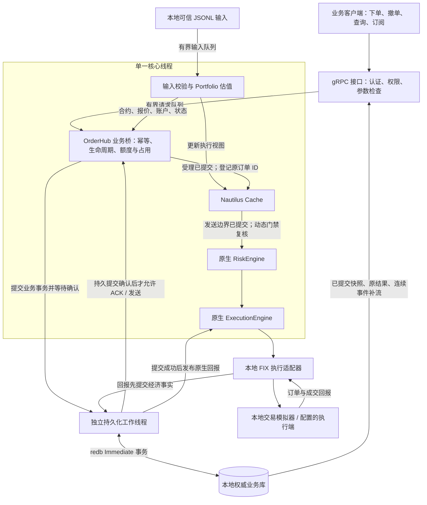
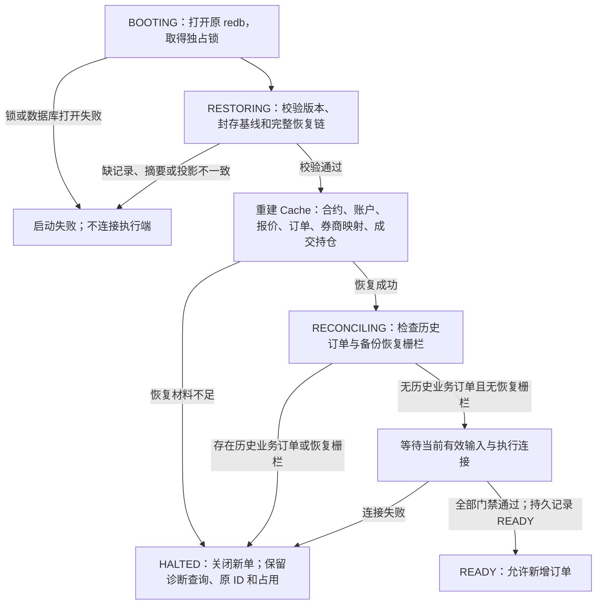

# NautilusTrader

This repository is an **independently maintained local derivative** of
[NautilusTrader](https://github.com/nautechsystems/nautilus_trader), adapted for an internal
OrderHub. The name and existing `nautilus-*` crate and API names remain for source compatibility.
This checkout is not an official Nautech Systems release, and upstream support, CI badges,
package indexes, and release channels do not describe it.

The source retains its original copyright notices and LGPL-3.0-only license. See [LICENSE](LICENSE)
and [TRADEMARK.md](TRADEMARK.md) for the applicable license and upstream trademark information.
Git history and inherited source files retain the project's provenance.

## Local scope

OrderHub adds a gateway, a node, and a gRPC contract around the Nautilus trading core:

- `crates/orderhub-gateway`: request admission bridge and local business journal.
- `crates/orderhub-node`: assembly and service binaries.
- `crates/orderhub-proto`: service contract and generated Rust types.
- `crates/orderhub-tools`: schema and repository checks, plus an optional offline catalog converter.

The retained Rust core includes Cache, execution, risk, portfolio, and OMS market inputs.
OrderHub owns lifecycle, journaling, checkpoints, and recovery. Redis and PostgreSQL integrations
remain as optional Rust backends; real service validation is required before activation.
The node currently rejects database activation flags. The research/backtest framework, general catalog, generic node, Python bindings,
and binary bus codecs are retired; source history is retained in the
[P7 retirement record](docs/orderhub/framework-retirement.md). Historical Parquet conversion is
isolated behind `orderhub-tools/legacy-catalog`. The OrderHub design documents in
[docs/orderhub](docs/orderhub) describe goals
and contracts; they should not be read as proof that every proposed behavior is implemented.

This software can execute live trades involving real capital. Validate risk controls, venue
configuration, persistence, recovery, and reconciliation for the intended environment before
connecting it to a live account.

The base node/client allow explicit loopback plaintext only. `grpc-tls` requires configured
certificate/key and explicit client trust/domain, with no plaintext fallback. `redis`,
`postgres`, and `postgres-tls` retain their build paths; the union shares one TLS provider.
See [TLS configuration and boundaries](docs/orderhub/tls.md).

P0-P8 passed their scoped Windows x64 local acceptance on 2026-10-11. See the
[P8 acceptance record](audit/orderhub-simplification-2026-10-10/run-18/P8-acceptance.md)
for evidence and deferred service, deployment and trading activation gates.

The subsequent `local-usd-v2` business rule revision removes the ±10% price band and quote
age/continuity admission gates. Valuation uses the last legal quote matching the instrument;
account/status freshness, cash/ownership limits, FIX, persistence and recovery gates still apply.
See the [current rule amendment](orderhub-project-simplification.md) and
[input contract](docs/orderhub/market-and-account-input.md). Original stage records retain their
original rule and evidence scope.
The [rule plan](docs/orderhub/quote-policy-v2-plan.md) and
[acceptance summary](docs/orderhub/quote-policy-v2-acceptance.md) record the subsequent change.

## 业务逻辑架构

当前节点的本地业务范围为 `AAPL.GOX`、账户 `GOX-001`、USD、整股及 `LIMIT + DAY`。
本地 JSONL 输入提供合约、报价、账户资金/策略归属和交易状态；FIX 通道提供执行回报。
本地输入夹具不能作为真实券商账户或交易所行情的证明。



图中的箭头表示业务依赖和提交顺序。RPC 通过有界队列交给核心线程，不直接访问 Cache；
节点的磁盘写入由持久化工作线程执行，核心线程仍需等待提交结果。
Redis/PostgreSQL 保留可选库和构建路径，当前节点不启用外部投影或数据库 outbox。

1. **受理与防重**：认证绑定提交方及策略权限。同代、同提交方、同方法、同请求 ID
   的相同业务参数返回原结果；参数不同则冲突，不创建第二笔订单。
2. **业务风控与估值**：使用领域数值类型和 `Decimal` 检查价格/数量增量、能力、截止时间、
   可用现金、持仓归属、费用预留、策略成本预算及市值敞口。
   `local-usd-v2` 使用最后合法且匹配当前合约的报价估值，取消 ±10% 价格带和报价年龄/
   连续性阻单检查；账户/状态时效、初始合法报价及其他风险门禁仍保留。
3. **先持久化再执行**：同一事务提交请求键、原结果、订单意图、资金/持仓占用、待发状态、
   日志、事件视图和恢复增量。成功提交前不返回受理 ACK、不发送订单。
   `DISPATCH_STARTED` 也先落盘，再经 Cache → RiskEngine → ExecutionEngine → FIX；
   受理 ACK 不代表执行端已经接受或成交。
4. **回报与经济结转**：回报携带稳定成交身份、精确数量/价格/费用及归属，先提交再发布。
   重复回报不重复结转；撤单请求不立即释放已发送订单的占用。
   提交结果未知、持久化失败或经济事实冲突会关闭新增风险，保留原 ID 和未解决占用。
5. **查询与补流**：`GetState` 和 `WatchEvents` 读取已提交账本及事件视图，受当前权限约束。
   快照固定提交版本，订阅按签名游标连续补流；内存广播和 Cache 不作为受理结果的权威来源。

详细规则见[业务运行时](docs/orderhub/business-runtime.md)、
[额度与占用契约](docs/orderhub/risk-and-reservations.md)及
[状态与事件流契约](docs/orderhub/state-and-event-stream.md)。

## 异常时从本地持久化恢复

### 保存的数据与提交边界

`ORDERHUB_JOURNAL` 指定专属 redb 文件，默认 `orderhub-journal.redb`。
它保存完整业务账本，不只是文本事务日志：请求与原结果、防重索引、订单与发送状态、
成交/费用、账户和策略占用、输入事实、查询/事件视图，以及恢复封存基线和连续事务增量。
业务 envelope 为 schema 1，恢复格式为版本 2；价格、数量、金额和费用保存精确十进制值。

`Durability::Immediate` 的事务提交是恢复边界，提交成功后才 ACK 或执行。
进程崩溃后的恢复以完整的已提交事务为准；客户端未收到 ACK 不能据此认定事务没有提交，
应使用原请求键查询或重试。设备损坏不能仅靠同盘日志恢复，需可验证备份；
当前证据覆盖本地进程故障，未认证所有存储设备的断电持久性。

### 崩溃或断连后的启动流程



1. **保护原库**：同一 redb 由独占锁防止并发写入。无法打开或完整验证的库会导致启动失败，
   不将损坏/未知版本的文件当空库继续运行。
2. **验证并重建**：从封存基线按连续序号重放恢复增量，校验 BLAKE3 摘要链，并与持久表逐项
   比较。随后重建 Cache 和执行持仓，核对成交身份及经济内容；不广播历史命令或历史事件。
   历史输入不恢复实时流有效性，启动仍需当前合约、合法匹配报价和账户/状态完整快照。
3. **分类保留订单**：未越过发送边界的未终态订单保留待发状态；已记录 `DISPATCH_STARTED`
   的未终态订单视为发送结果未知，保留资金/持仓占用。两类均不会在恢复时自动重发、
   换订单 ID 或因重启释放占用。同代同键重试仍返回原结果。
4. **外部对账边界**：本地库无法证明执行端在崩溃期间没有收到订单或产生新成交。
   当前适配器缺少完整账户、订单、成交和持仓查询，因此**任何存在历史业务订单的库重启后
   都保持 `HALTED`**，包括历史订单已经终态的情况。完整自动对账及恢复交易尚未实现；
   重连成功或本地重放成功均不会自动解除这一门禁。

正常 Ctrl+C 停止会持久记录 `DRAINING`，以 250 ms 本地窗口收取回报并排空已有工作，
随后记录 `STOPPED` 并发布一致检查点。强制终止无法保证生成退出检查点，
仍从原 redb 的完整已提交历史恢复。未解决占用不会因退出释放。

### 检查点、备份与离线恢复

检查点目录由 `ORDERHUB_CHECKPOINT_DIR` 指定，默认将 journal 扩展名改为 `checkpoints`。
检查点从一致的逻辑读视图生成，先同步不可变 blob，再发布 manifest；清单包含 epoch、
提交水位、长度、摘要、实例及程序/配置标识。节点启动校验原库的完整封存基线和增量，
不会自动寻找检查点或自动回退备份。检查点与同代完整增量尾的验证接口另行保留；
备份损坏不能通过跳过坏记录继续交易。

先停止活动节点并确认其释放数据库锁，再运行离线工具：

```bash
cargo build --locked --profile nextest -p orderhub-node --bin orderhub-recovery
orderhub-recovery inspect JOURNAL
orderhub-recovery backup JOURNAL DIRECTORY
orderhub-recovery restore MANIFEST NEW-JOURNAL
```

`backup` 输出 manifest 路径。`restore` 要求目标文件不存在，验证备份后在同目录 staging 库
完整落盘，使用同文件系统 hard link 发布目标，失败明确报错；不会覆盖原库。
恢复生成新 epoch、轮换订阅签名密钥并设置恢复栅栏，保留原客户订单 ID、归属和占用，
启动后保持 `HALTED`。使用新 epoch 查询原订单；旧代变更请求及订阅 token 失效。
备份只覆盖其水位，之后的外部成交仍需对账；跨主机接管还必须隔离旧实例及其执行连接。

当前没有自动定时备份、日志回收或完整自动对账；15 分钟备份 RPO、30 分钟自动 READY RTO
仍是待验证目标。实现与运维细节见[恢复运行时](docs/orderhub/recovery-runtime.md)，
更完整的设计目标见[恢复与对账契约](docs/orderhub/recovery-and-reconciliation.md)。

## Build and test from this checkout

Use the stable Rust toolchain pinned in [rust-toolchain.toml](rust-toolchain.toml), including
its rustfmt and Clippy components. From the repository root:

```bash
cargo fmt --all -- --check
cargo check --locked --profile nextest --workspace --all-targets
cargo clippy --locked --profile nextest -p orderhub-gateway -p orderhub-node -p orderhub-proto -p orderhub-tools --all-targets -- -D warnings
cargo test --locked --profile nextest -p orderhub-gateway -p orderhub-node -p orderhub-proto -p orderhub-tools --lib --bins
```

These checks compile and test local code without invoking the separate local exchange executable.
The integration tests for Redis, PostgreSQL, market
data, and venue connectivity may require additional local services or fixtures; see their
respective test documentation before running them. The CI workflow does not start a separate
`rust-trader` exchange process.

`nautilus-testkit` retains the in-memory Cache double and event collection helpers.
Tests use checked-in local fixtures and do not download datasets.

The supported development and schema tools require no Python/PyO3 environment. See
[CONTRIBUTING.md](CONTRIBUTING.md) for the local change and validation process.

## Documentation and project routing

- [OrderHub design and status](docs/orderhub)
- [Developer guide](docs/developer_guide) (inherited technical reference; upstream release and
  contribution procedures do not govern this checkout)
- [Security reporting](SECURITY.md)
- [Local roadmap](ROADMAP.md)
- [AI policy](AI_POLICY.md)

Local issues, security reports, deployment decisions, and release decisions belong to the owner
of this checkout. Do not send them to upstream NautilusTrader services or maintainers. The
historical [CLA.md](CLA.md) remains as source history and does not gate local contributions.
The `kmind-git/nautilus_trader` Git remote is a personal fork; these local changes have not been
published as a separate GitHub project.
